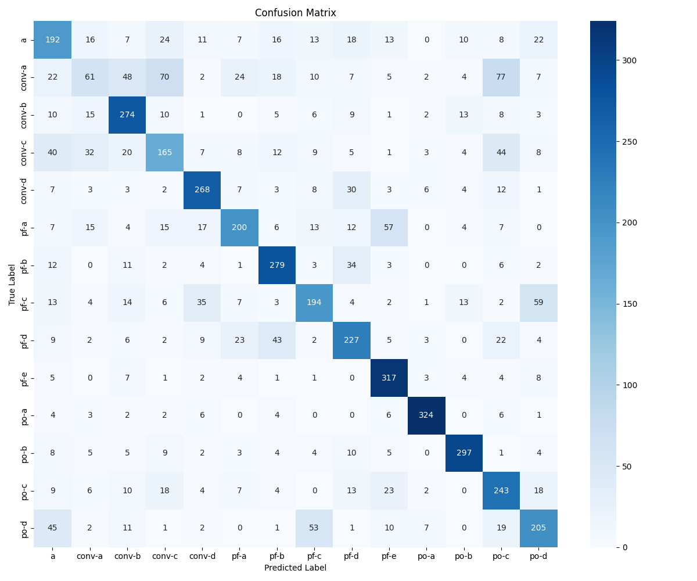

# Automated Error Detection in Math with LLMs

A MathBERT-based system that reads a student's fraction computation and identifies **which kind of mistake** they made, so teachers can see the misconception behind a wrong answer instead of just marking it wrong.

📄 Accepted at the **American Educational Research Association (AERA) Annual Meeting 2026**:
*"Automated Error Classification and Analysis of Fraction Computation Leveraging Large Language Models."*

---

## Results

| Metric | Value |
|---|---|
| Error categories | 14 |
| Macro-F1 | ~76% |
| Improvement from imbalance handling | +30% macro-F1 |
| Label consistency gain from SymPy normalization | ~20% |



---

## The problem

When a student gets a fraction problem wrong, the wrong answer alone doesn't say *why*. Did they add the denominators? Mix up whole and fractional parts in a mixed number? Flip the wrong fraction when dividing? This project classifies each wrong answer into one of 14 error types, which makes the diagnosis automatic and scalable.

## Approach

1. **Data.** The research model was trained on real student work combined with generated examples. The real student data is private and is **not** included here. This repo contains the synthetic data generators and synthetic datasets (30K examples, 14 labels) so the pipeline can be run end to end.
2. **Symbolic validation.** Student expressions are normalized and checked with **SymPy**, which made error labels about 20% more consistent.
3. **Baseline.** In the research, a LightGBM model with TF-IDF features gave a quick benchmark to measure progress against.
4. **Transformer model.** Fine-tuned **MathBERT** (`tbs17/MathBERT`) with a custom classification head (two linear layers with dropout on the [CLS] embedding).
5. **Class imbalance.** Some error types are rare. **Focal loss** combined with **balanced class weights** raised macro-F1 by 30%.

Each training example pairs the LaTeX problem and student answer with a short text description:

```
[CLS] \frac{14}{19} + \frac{4}{2} = \frac{6}{7} [SEP] The problem is 14/19 + 4/2. The student response is 6/7. [SEP] ...
```

## Tech stack

Python · PyTorch · Hugging Face Transformers (MathBERT) · SymPy · scikit-learn · Pandas

## How to run

```bash
pip install torch transformers sympy pandas scikit-learn matplotlib seaborn

# 1. Generate synthetic training data → improved_diversed_data.csv
python generate_improved_errors.py

# 2. Fine-tune MathBERT with focal loss + class weights → best_mathbert_model.pt
python new_train.py

# 3. Run predictions (expects test_set.csv and best_mathbert_model.pt in the working directory)
cp outputs_mathbert/test_set.csv .
python predict_model.py
```

A GPU is strongly recommended for training.

## Repository structure

| File | Purpose |
|---|---|
| `generate_improved_errors.py` | Generates the synthetic training set with labeled errors |
| `generate_data.py`, `generate_diverse_data_with_context.py` | Earlier data generators (produce `diversed-data.csv`) |
| `generate_data_llm.ipynb` | LLM-assisted data generation experiments |
| `mathbert_ingest_pipeline.py` | Preprocessing and SymPy-based normalization into MathBERT-ready input |
| `new_train.py` | Main training script: MathBERT + focal loss + class weights |
| `train_model.py`, `train_model.ipynb`, `train_math_bert_classifier.ipynb` | Earlier training experiments |
| `predict_model.py` | Loads the trained model and classifies new examples |
| `diversed-data.csv`, `mathbert_fractions.csv` | Synthetic datasets (30K examples each) |
| `outputs_mathbert/test_set.csv` | Held-out test set |
| `confusion_matrix.png` | Per-class evaluation results |

---

**Author:** Isha Patil · [LinkedIn](https://linkedin.com/in/isha-patil224) · isha00364@gmail.com
